# Testler

## Otomatik testler

```bash
npm test
```

Testler geçici veri dosyalarında çalışır; uygulamanın görev kayıtlarını değiştirmez.

- `testler/gorevler.test.js`: CRUD, veri kalıcılığı, alan doğrulama, bozuk JSON, istek boyutu sınırı ve bulunamayan görevler.
- `testler/gelismis_ozellikler.test.js`: Filtreleme, arama, çalışan bazlı listeleme, sıralama, sayfalama, raporlar ve geçersiz sorgular.

## Postman testleri

`postman/gorev_yonetimi.postman_collection.json` dosyası 15 istek ve 30 kontrol içerir. İstekler koleksiyondaki sırayla çalıştırılır. Oluşturulan görevin kimliği otomatik kaydedilir; akışın sonunda görev silinir.

| Görüntü | İşlem | Beklenen HTTP kodu |
| --- | --- | --- |
| [01](ekran_goruntuleri/01_ekleme.png) | Görev ekleme | 201 |
| [02](ekran_goruntuleri/02_listeleme.png) | Görev listeleme | 200 |
| [03](ekran_goruntuleri/03_detay.png) | Görev detayı | 200 |
| [04](ekran_goruntuleri/04_guncelleme.png) | Görev güncelleme | 200 |
| [04a](ekran_goruntuleri/04a_durum_filtresi.png) | Durum filtresi | 200 |
| [04b](ekran_goruntuleri/04b_oncelik_filtresi.png) | Öncelik filtresi | 200 |
| [04c](ekran_goruntuleri/04c_gorev_arama.png) | Başlık/açıklama araması | 200 |
| [04d](ekran_goruntuleri/04d_calisan_gorevleri.png) | Çalışanın görevleri | 200 |
| [04e](ekran_goruntuleri/04e_sayfalama_siralama.png) | Sayfalama ve sıralama | 200 |
| [04f](ekran_goruntuleri/04f_tamamlanan_raporu.png) | Tamamlanan görev sayısı | 200 |
| [04g](ekran_goruntuleri/04g_bekleyen_raporu.png) | Bekleyen görev sayısı | 200 |
| [04h](ekran_goruntuleri/04h_genel_rapor.png) | Genel rapor | 200 |
| [04i](ekran_goruntuleri/04i_eksik_veri.png) | Eksik veriyle görev ekleme | 400 |
| [05](ekran_goruntuleri/05_silme.png) | Görev silme | 204 |
| [06](ekran_goruntuleri/06_silinen_gorev.png) | Silinen görevi sorgulama | 404 |

## Ekran görüntüleri

Her başlık ilgili Postman isteğinin ekran görüntüsünü açar. Eksik veri için `400`, silinen görev için `404` beklenen sonuçtur.

<details open>
<summary>01 — Görev ekleme — 201 Created</summary>

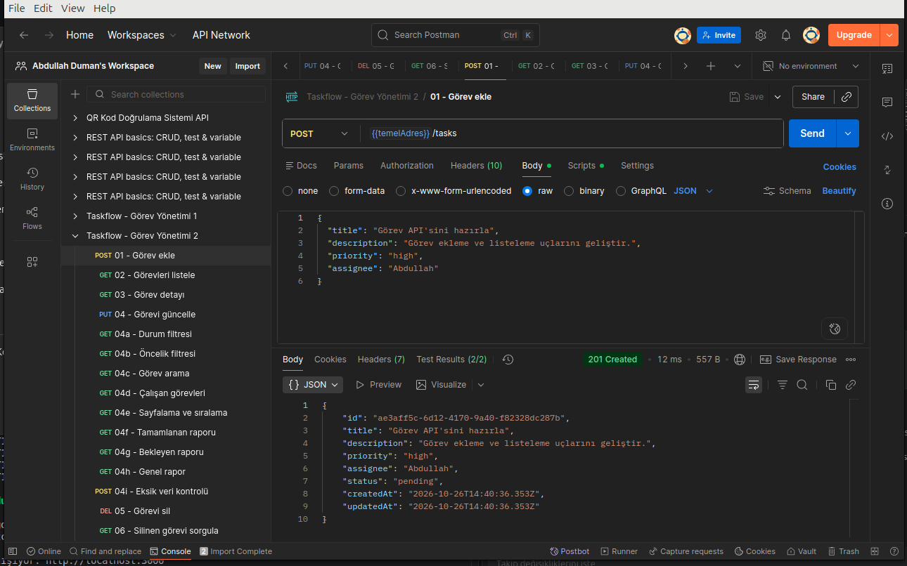

</details>

<details>
<summary>02 — Görev listeleme — 200 OK</summary>

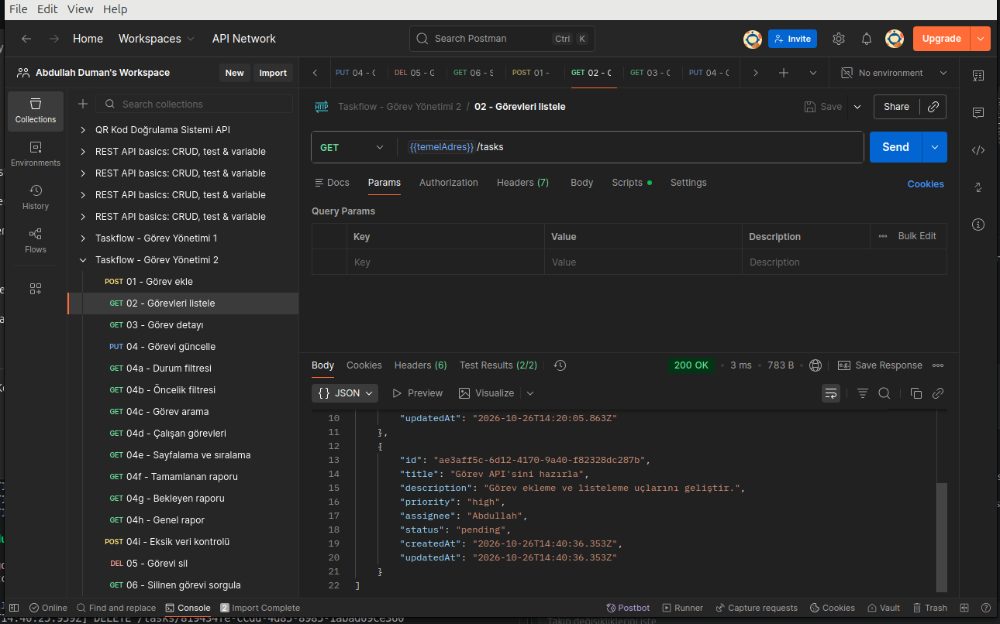

</details>

<details>
<summary>03 — Görev detayı — 200 OK</summary>

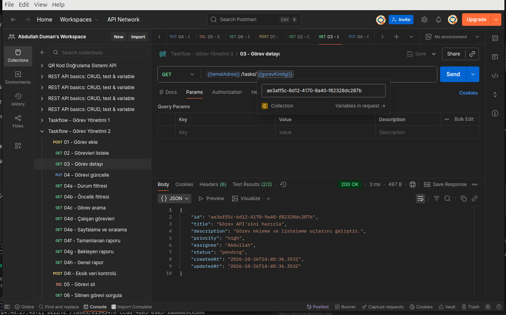

</details>

<details>
<summary>04 — Görev güncelleme — 200 OK</summary>

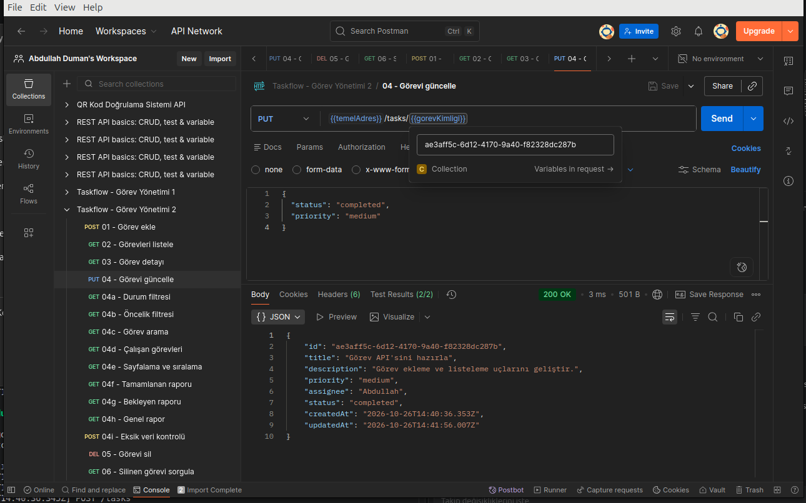

</details>

<details>
<summary>04a — Durum filtresi — 200 OK</summary>

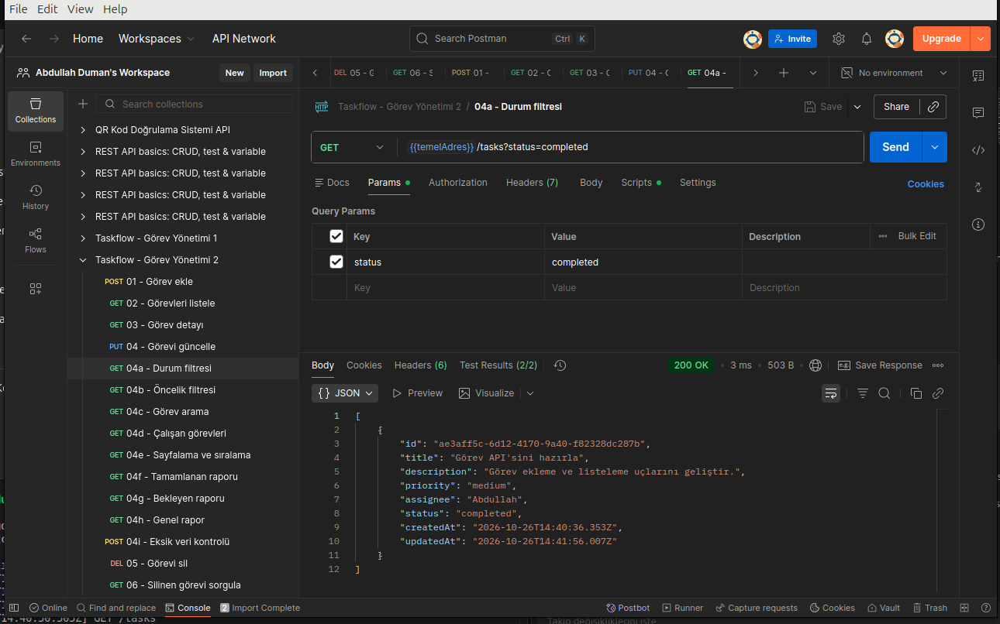

</details>

<details>
<summary>04b — Öncelik filtresi — 200 OK</summary>

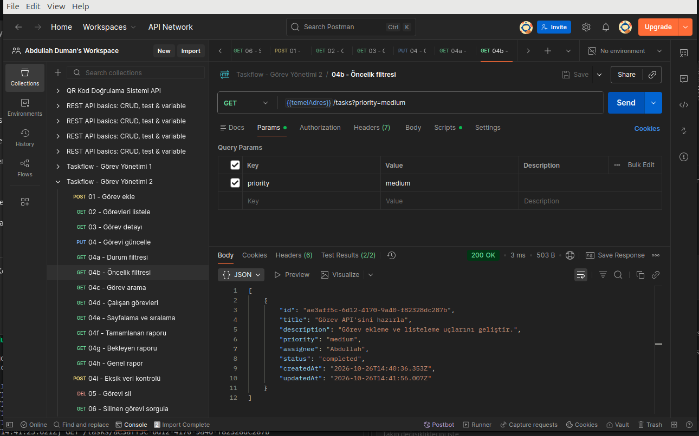

</details>

<details>
<summary>04c — Görev arama — 200 OK</summary>

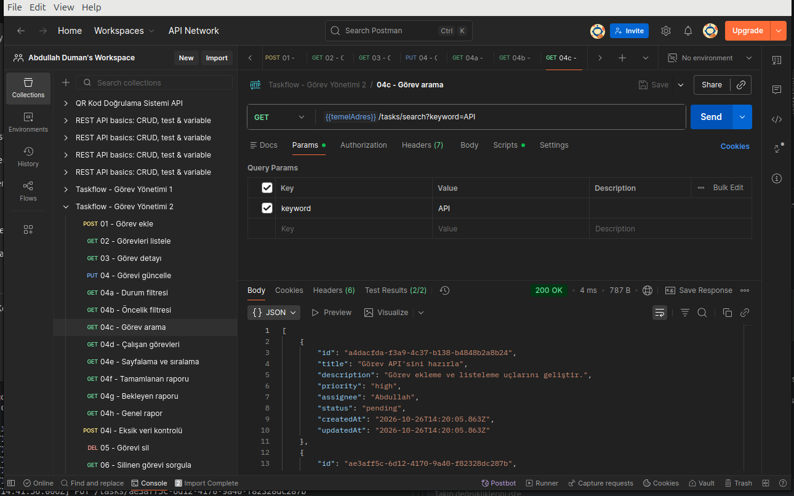

</details>

<details>
<summary>04d — Çalışanın görevleri — 200 OK</summary>

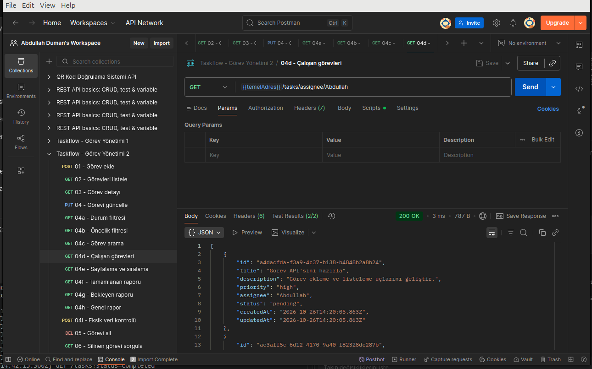

</details>

<details>
<summary>04e — Sayfalama ve sıralama — 200 OK</summary>

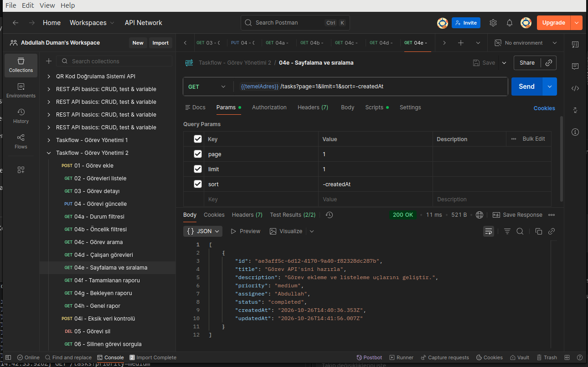

</details>

<details>
<summary>04f — Tamamlanan görev raporu — 200 OK</summary>

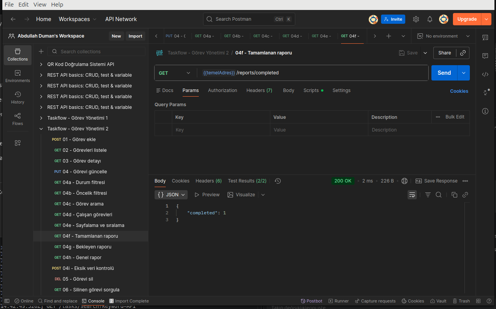

</details>

<details>
<summary>04g — Bekleyen görev raporu — 200 OK</summary>

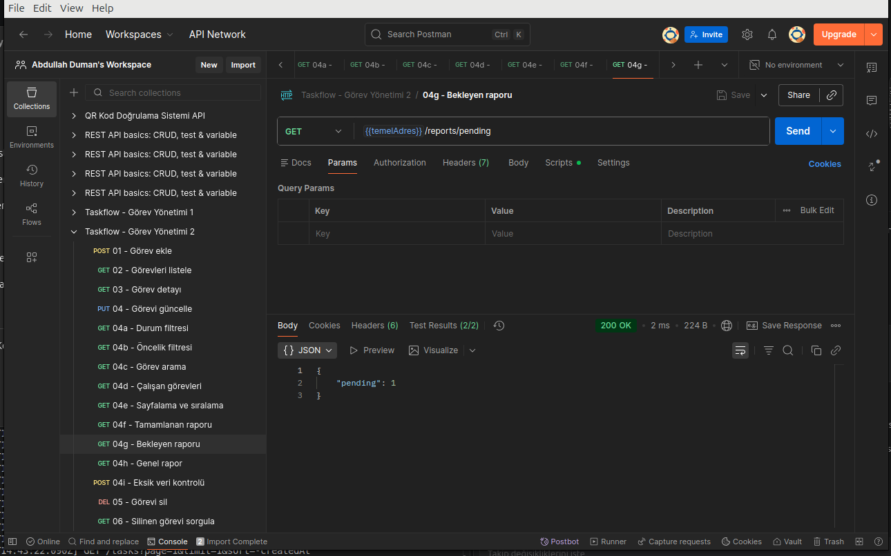

</details>

<details>
<summary>04h — Genel rapor — 200 OK</summary>

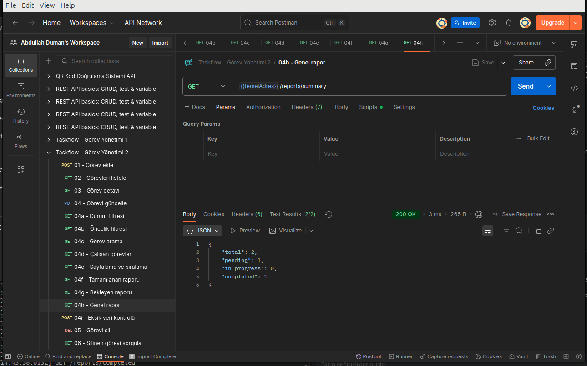

</details>

<details>
<summary>04i — Eksik verinin reddedilmesi — 400 Bad Request</summary>

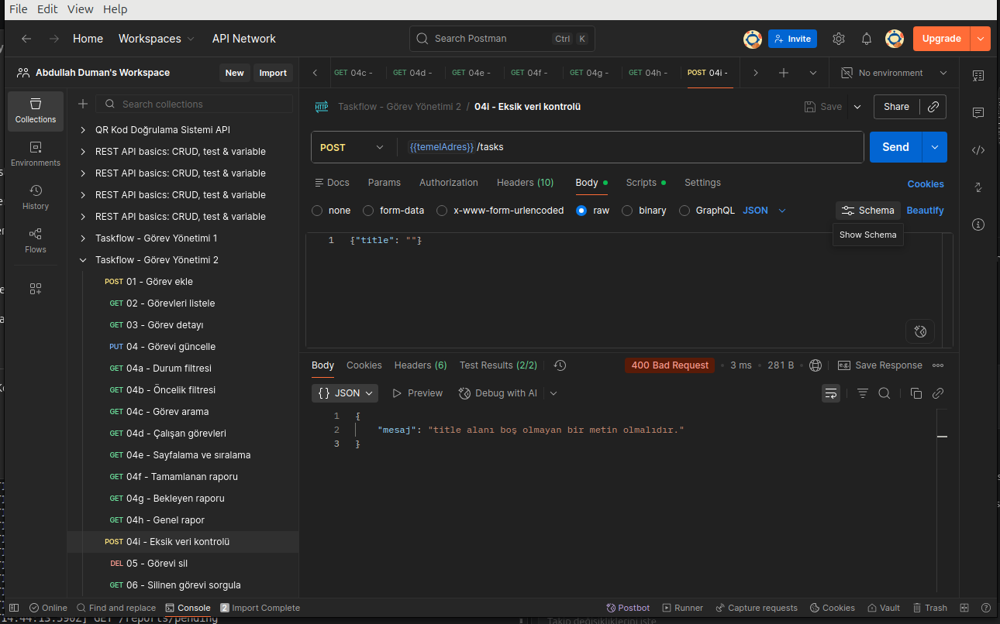

</details>

<details>
<summary>05 — Görev silme — 204 No Content</summary>

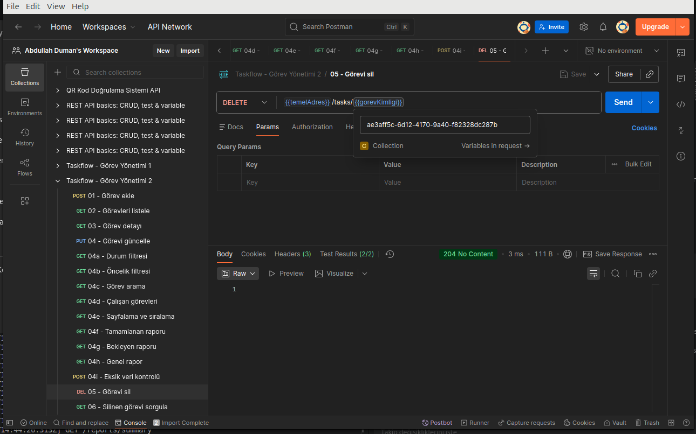

</details>

<details>
<summary>06 — Silinen görevi sorgulama — 404 Not Found</summary>

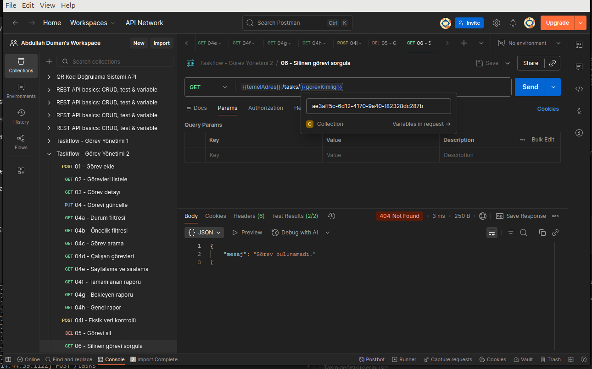

</details>
